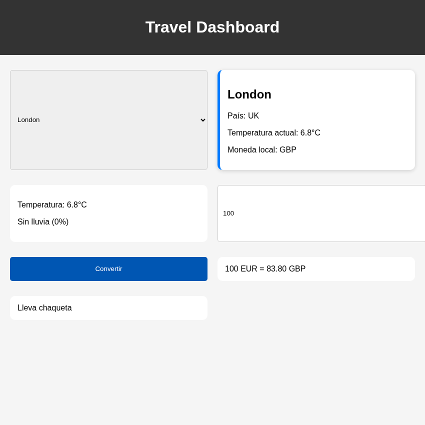

# Travel Dashboard

Panel web para consultar temperatura y probabilidad de lluvia por ciudad, y convertir euros a moneda local.

[Demostración web](https://travel-dashboard-amber-phi.vercel.app/)

## Cómo probarlo

Abre `index.html` o ejecuta `python -m http.server 8000` desde el repositorio y abre `http://localhost:8000`. Selecciona Londres, comprueba el pronóstico y convierte 100 EUR a GBP. Para reproducir un fallo, bloquea desde las herramientas del navegador `api.open-meteo.com` o `api.exchangerate-api.com` y repite la operación. Cada servicio muestra su propio error y el otro sigue disponible.

